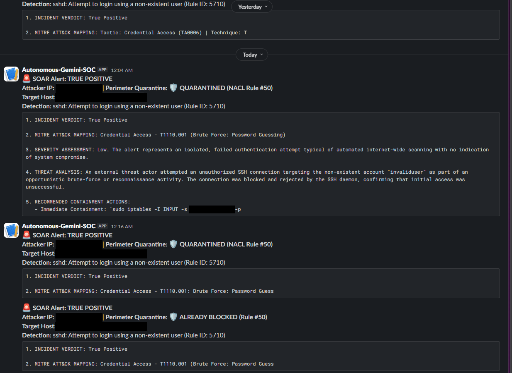
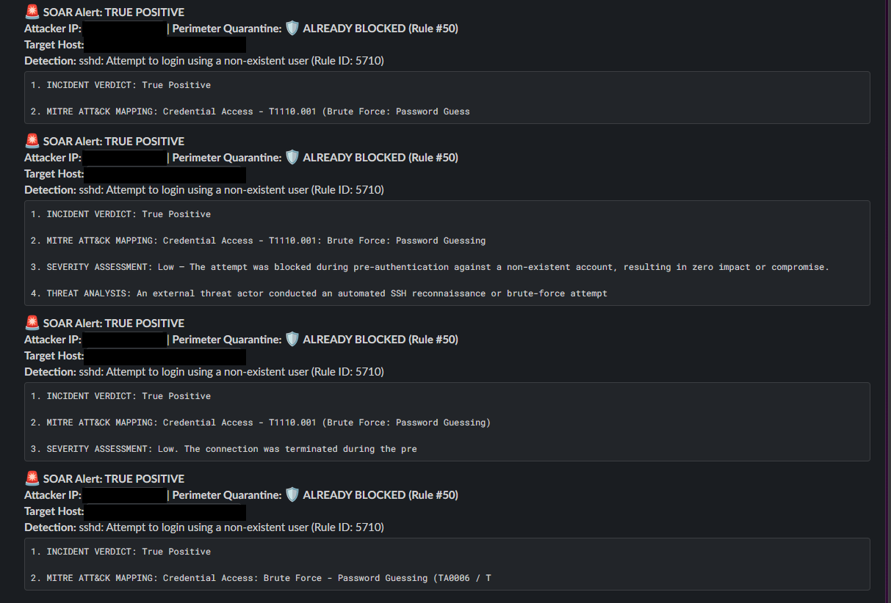
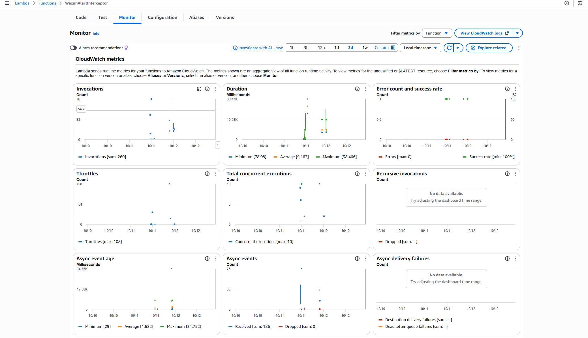
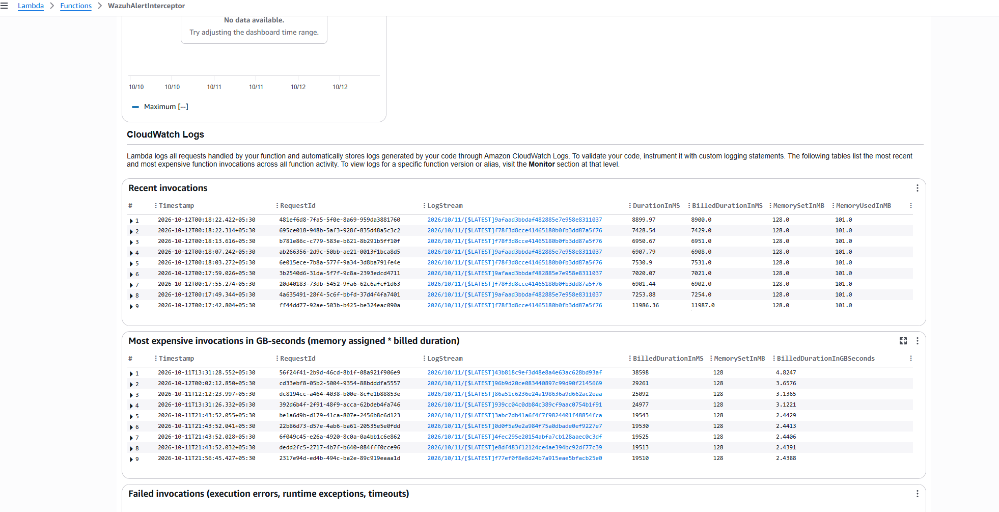

# Serverless AI SIEM + SOAR on AWS

A low-cost, event-driven security pipeline. Wazuh detects an SSH brute-force attempt, Gemini triages it, and a Lambda function blocks the attacker at the VPC Network ACL and posts the result to Slack. No human in the loop, and it runs on AWS Free Tier services.

**Live architecture demo:** https://penguin-domain.github.io/serverless-soar/

---

## Architecture

```
[Attacker]
    |  SSH brute force
    v
[EC2 t2.micro: headless Wazuh manager]
    |  forwarder.py tails alerts.json, keeps Level 7+
    v
[EventBridge]  -->  [SQS queue + DLQ]  -->  [Lambda, Python 3.12]
                                                |-->  [Gemini: verdict + MITRE ATT&CK]
                                                |-->  [VPC Network ACL: inbound DENY]
                                                '-->  [Slack: incident card]
```

1. **Detection.** A standalone Wazuh manager (no indexer, no dashboard) on a `t2.micro`.
2. **Forwarding.** `forwarder/forwarder.py` follows `alerts.json`, survives log rotation, drops alerts below Level 7, and calls `events:PutEvents` using the instance profile. No static AWS keys.
3. **Buffering.** EventBridge routes to an SQS queue with a dead-letter queue. The Lambda event source is capped at a maximum concurrency of 2.
4. **Triage.** `lambda/lambda_function.py` uses only the standard library (`urllib`) to call Gemini with a Tier-2 analyst prompt and a JSON-only response. Retries with exponential backoff on HTTP 429/503 and socket timeouts. If it still fails, the exception goes back to SQS, which retries and then parks the message in the DLQ.
5. **Containment.** On a true positive, Boto3 adds an inbound DENY entry for `<ip>/32` in the first free slot of rules 50-99. Re-checking existing entries first makes it idempotent. It skips private, loopback and allowlisted IPs.
6. **ChatOps.** A Slack webhook posts the verdict, MITRE technique, confidence and containment status.

---

## Evidence from the running pipeline

Attacker IPs are redacted. Everything below is from a real run in my AWS account. A PDF copy is in [`docs/screenshots.pdf`](docs/screenshots.pdf).

### Slack incident cards
Verdict, MITRE ATT&CK mapping (T1110.001, Brute Force: Password Guessing) and containment status for an inbound SSH brute-force attempt.



### Idempotency
Repeat alerts for an IP that already has a deny rule report `ALREADY BLOCKED` instead of creating a duplicate NACL entry.



> These two cards are from an earlier build. The current `lambda_function.py` formats the Slack message differently and no longer re-posts for an IP that is already blocked.

### Lambda metrics (3-day window, 10-12 Oct 2026)



| Metric | Value |
|---|---|
| Invocations | 260 |
| Errors | 0 (success rate 100%) |
| Average duration | about 9.2 s (max 38.5 s) |
| Async events dropped | 0 |
| Throttles (peak) | 108 |
| Concurrent executions (peak) | 10 |

The throttle and concurrency peaks come from earlier test runs, before the SQS concurrency cap of 2 was in place.

### Recent invocations



Each alert takes roughly 7-12 s end to end, dominated by the Gemini call, and uses about 101 MB of the 128 MB allocated.

---

## Problems I hit and how I fixed them

### 1. Memory starvation on a free-tier EC2
**Issue:** the default Wazuh install brings an indexer and dashboard. A `t2.micro` ran out of memory, thrashed swap and froze.
**Fix:** run only the manager daemons (`wazuh-analysisd`, `wazuh-syscheckd`, `wazuh-logcollector`). Memory stays around 180 MB.

### 2. Burst traffic and Gemini rate limits (HTTP 429)
**Issue:** a brute-force run produced dozens of alerts within seconds. With EventBridge invoking Lambda directly, each alert started its own execution and the free-tier request limit was exhausted.
**Fix:** put SQS between EventBridge and Lambda, cap the event source at a maximum concurrency of 2, and only forward Level 7+ alerts.

### 3. API socket timeouts
**Issue:** the LLM API sometimes hung. The first version only caught HTTP errors, so a `TimeoutError` ended the invocation with no retry.
**Fix:** a retry wrapper with exponential backoff that handles `HTTPError` (429/503), `URLError` and `TimeoutError`, with a 12 s socket timeout so the function fails fast and stays inside its 60 s limit.

---

## Repository layout

```
.
├── index.html                    # interactive architecture demo (GitHub Pages)
├── forwarder/forwarder.py        # tails Wazuh alerts.json, pushes to EventBridge
├── lambda/lambda_function.py     # Gemini triage, NACL block, Slack notify
├── deploy/wazuh-courier.service  # systemd unit for the forwarder
└── docs/
    ├── screenshots/              # real captures (IPs redacted)
    └── screenshots.pdf
```

---

## Setup

### 1. EC2 and Wazuh
1. Launch an Ubuntu 22.04 `t2.micro` in your VPC.
2. Add the Wazuh apt repository (see the [Wazuh install docs](https://documentation.wazuh.com/current/installation-guide/wazuh-server/index.html)), then:
   ```bash
   sudo apt-get update
   sudo apt-get install -y wazuh-manager python3-boto3
   sudo systemctl enable --now wazuh-manager
   ```
3. Attach an instance profile that allows `events:PutEvents`.

### 2. Forwarder
```bash
sudo cp forwarder/forwarder.py /opt/forwarder.py
sudo cp deploy/wazuh-courier.service /etc/systemd/system/
sudo systemctl daemon-reload
sudo systemctl enable --now wazuh-courier.service
```

### 3. SQS, EventBridge, Lambda
1. Create a standard SQS queue `siem-alert-queue` with a dead-letter queue. Set its **visibility timeout to at least 360 s** (6x the Lambda timeout).
2. Create an EventBridge rule with this pattern and target the queue:
   ```json
   { "source": ["wazuh.siem"], "detail-type": ["Security Alert"] }
   ```
3. Add a queue policy that allows `events.amazonaws.com` to `sqs:SendMessage`, scoped to the rule's ARN.
4. Create the Lambda (Python 3.12, timeout 60 s) from `lambda/lambda_function.py` with these environment variables:

   | Variable | Value |
   |---|---|
   | `GEMINI_API_KEY` | Google AI Studio key |
   | `VPC_NACL_ID` | e.g. `acl-0123456789abcdef0` |
   | `SLACK_WEBHOOK_URL` | Slack incoming webhook (optional) |
   | `ALLOWLIST` | comma-separated IPs never to block. **Include your own admin IP.** |

5. Lambda role permissions: `ec2:DescribeNetworkAcls`, `ec2:CreateNetworkAclEntry` and the standard SQS execution policy.
6. Add the SQS trigger with **batch size 1** and **maximum concurrency 2**.
7. Keep your NACL allow rules at 100 and above. Deny rules are written to 50-99.

### 4. Verify
From another machine:
```bash
for i in {1..8}; do ssh fakeuser@<EC2_PUBLIC_IP>; done
```
Expected, in order:
- Wazuh correlates the failures (Rule 5712, Level 10).
- The alert appears in SQS and is picked up by Lambda.
- CloudWatch shows the Gemini verdict, for example MITRE T1110.001.
- A new inbound DENY entry for `<attacker_ip>/32` appears in the NACL.
- A Slack card reports the containment status.

---

## Limitations

- IPv4 only. IPv6 sources are not handled.
- Network ACLs are stateless and apply to the whole subnet. The default quota is 20 inbound rules per ACL, so the pipeline stops blocking when the ACL is full ("ACL full, not blocked").
- The block decision is made by an LLM. Keep the allowlist current, and add a human approval step before using something like this in production.
- The Gemini key is stored in a Lambda environment variable. Use Secrets Manager for anything beyond a lab.
- Rule 5712 and similar SSH rules are what this was tested against. Other rule types have not been tested.
